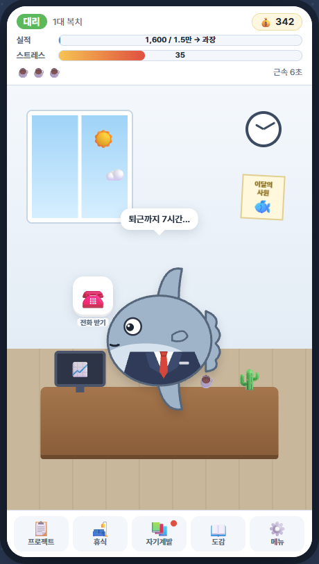
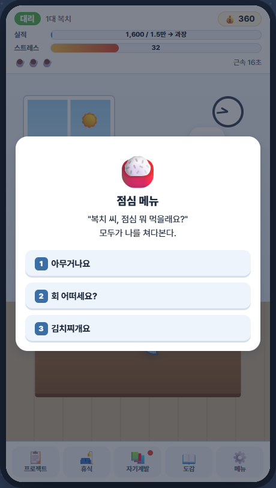
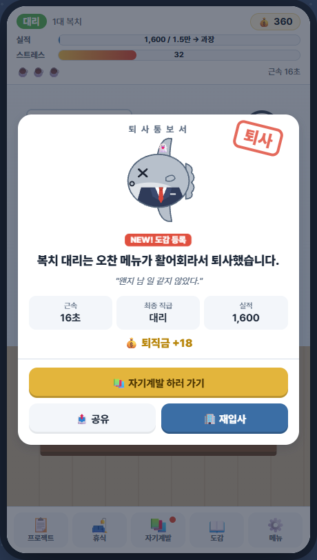

<div align="center">

# 🐟 개복치 신입사원

**세상에서 가장 예민한 신입사원을 회장까지 키워라!**

정장 입은 개복치 **복치**는 사소한 일로 퇴사합니다. 정말 사소한 일로.<br>
하지만 퇴사할수록 강해집니다.

### [▶ 지금 바로 플레이하기](https://oh-bj.github.io/bokchi-sawon/)

설치 없음 · 폰/PC 모두 가능 · 무료

  

</div>

---

## 이런 게임이에요

> 복치 대리는 **오찬 메뉴가 활어회라서** 퇴사했습니다.<br>
> 복치 인턴은 **실수로 전체답장을 눌러 사내 3천 명에게 '부장님 진짜 노답'을 보내서** 퇴사했습니다.<br>
> 복치 사원은 **부장님이 카톡에 'ㅇㅋ'라고만 답장해서** 퇴사했습니다.

옛날 폰 게임 「개복치 키우기」에서 영감을 받은 **병맛 직장인 육성 게임**입니다.
인턴으로 입사한 복치를 사원 → 대리 → 과장 → … → **회장**까지 올려 보세요.
물론 쉽지 않습니다. 복치는 개복치니까요.

| | |
|---|---|
| 🏢 직급 | 인턴부터 회장까지 9단계 |
| 💀 퇴사 도감 | 134종의 어이없는 퇴사 사유 |
| 💬 이벤트 | 선택지 50종 (뭘 고르면 퇴사할지 아무도 모른다) |
| 📋 프로젝트 | 15종 + 타이밍/연타 미니게임 |
| 🚨 돌발 상황 | 부장님 순찰, 대표님 등장, 정적 타임 |
| 🏁 엔딩 | 5종 (히든 엔딩 포함) |
| ⏱ 플레이 타임 | 메인 엔딩까지 약 2.5~3시간, 도감 완성은 그 이상 |
| 😵 난이도 | 어려움. 첫 퇴사까지 평균 20초 |

## 플레이 방법

1. 떠다니는 **업무 아이콘**을 터치해서 실적을 쌓고 승진하세요.
2. **스트레스**가 100이 되면 번아웃으로 퇴사합니다. 틈틈이 **휴식**하세요. (휴식 중에도 퇴사할 수 있습니다)
3. **프로젝트**는 커피 ☕ 한 잔으로 도전합니다. 성공하면 큰 실적, 실패하면... 퇴사할 수도 있습니다.
4. 빨간 테두리가 있는 업무는 **수상한 업무**입니다. 보상이 크지만 위험합니다.
5. **돌발 상황**에 대처하세요.
   - 👀 부장님 순찰: 3초 안에 업무 처리
   - 🕴️ 대표님 등장: 3초 안에 업무 2개 처리
   - 🤫 정적 타임: 아무것도 누르지 말 것
6. 퇴사하면 **퇴직금**으로 **자기계발**을 하고 재입사하세요. 같은 이유로 퇴사할수록 **내성**이 생깁니다.
7. 💰 월급 봉투가 날아가면 놓치지 말고 터치하세요!

**PC 단축키**: 선택지 `1`~`4` · 미니게임 `스페이스` · 창 닫기 `Esc`

## 폰에 앱처럼 설치하기

- **아이폰**: Safari로 열기 → 공유 버튼 → **홈 화면에 추가**
- **안드로이드**: Chrome으로 열기 → 메뉴(⋮) → **홈 화면에 추가** 또는 **앱 설치**

> 💡 카카오톡에서 링크를 열었다면 오른쪽 위 메뉴에서 **"다른 브라우저로 열기"**를 눌러 주세요. 카톡 내부 브라우저에서는 저장이 잘 안 될 수 있어요.

> 💾 진행 상황은 각자의 기기 브라우저에 저장됩니다. (기기 간 연동은 되지 않아요)

퇴사 화면의 **📤 공유** 버튼으로 퇴사 카드 이미지를 친구에게 보내 보세요!

---

## 개발자용

빌드 도구 없는 순수 HTML / CSS / JavaScript 게임입니다. PWA로 오프라인 플레이도 지원합니다.

### 로컬 실행

```bash
# 그냥 열기
index.html 더블클릭

# 또는 로컬 서버 (같은 와이파이의 폰에서도 접속 가능)
start-server.bat          # Windows
python -m http.server 8080
```

테스트할 때는 `index.html?speed=5` 처럼 붙이면 게임 시간이 5배속으로 흐릅니다.

### 폴더 구조

```
index.html             진입점 (스크립트 로드 순서 정의)
manifest.webmanifest   PWA 설정
sw.js                  오프라인 캐시 (배포 후 파일을 고치면 VERSION을 올릴 것)
css/                   base(색·레이아웃) / game(사무실·캐릭터) / ui(모달·버튼)
js/core/               네임스페이스, 유틸, 저장, 효과음(WebAudio)
js/data/               ★ 콘텐츠: 직급, 업무, 퇴사 사유, 이벤트, 프로젝트, 업그레이드, 엔딩
js/systems/            규칙: economy.js(밸런스 수식), rules.js(판정), state.js(세이브 구조)
js/ui/                 화면: HUD, 사무실, 모달, 미니게임, 공유 카드, 캐릭터 SVG
js/main.js             게임 루프
tools/balance-sim.js   밸런스 시뮬레이터
tools/make-icons.py    앱 아이콘 생성
docs/PLAN.md           기획서
```

게임 로직(`js/data`, `js/systems`)은 DOM에 의존하지 않아서 Node에서 그대로 돌릴 수 있습니다.

### 콘텐츠 추가

- **퇴사 사유**: `js/data/deaths.js`에 `d('id', '분류', 직급, '이유', '한마디', '힌트')` 한 줄을 추가하고, 이벤트·프로젝트·함정 중 한 곳에서 그 id를 사용합니다.
- **이벤트**: `js/data/events.js`에 `ev({...})` 블록을 추가합니다. 기존 이벤트를 복사해서 고치면 쉽습니다.

### 밸런스 조정

수치는 `js/systems/economy.js`, `js/data/ranks.js`, `js/data/upgrades.js`에만 있습니다.
고친 뒤에는 시뮬레이터로 직급별 도달 시간을 확인하세요.

```bash
node tools/balance-sim.js 40
```

현재 기준으로 쉬지 않고 최적으로 플레이하는 봇이 회장까지 약 100분 걸립니다. 사람 기준으로는 약 2.5~3시간입니다.
